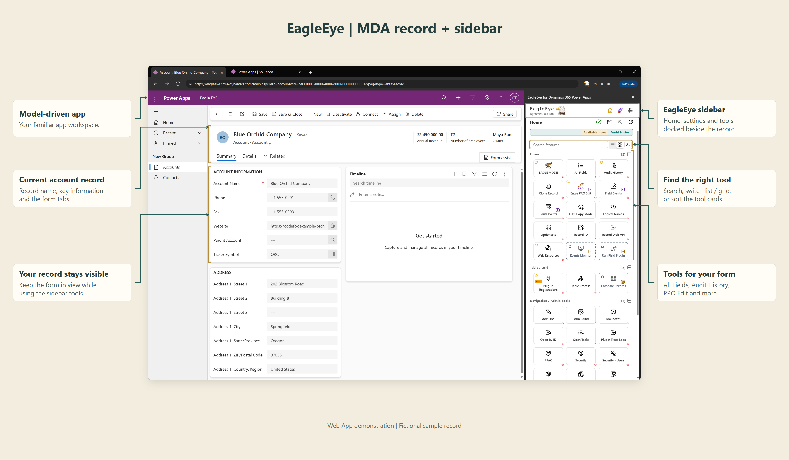
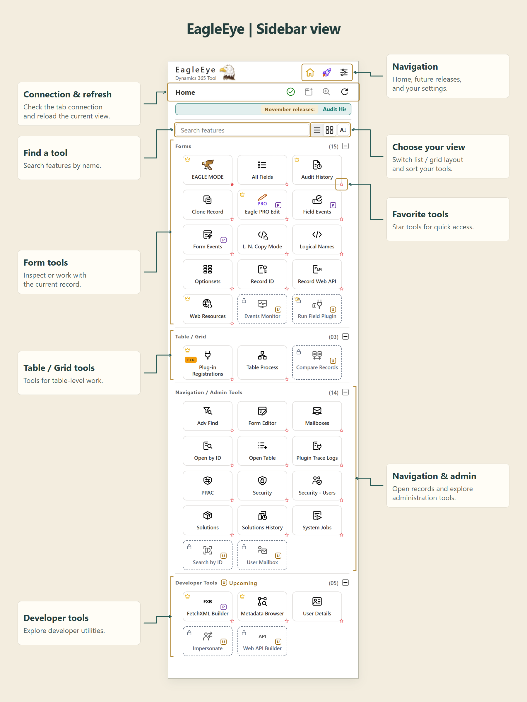
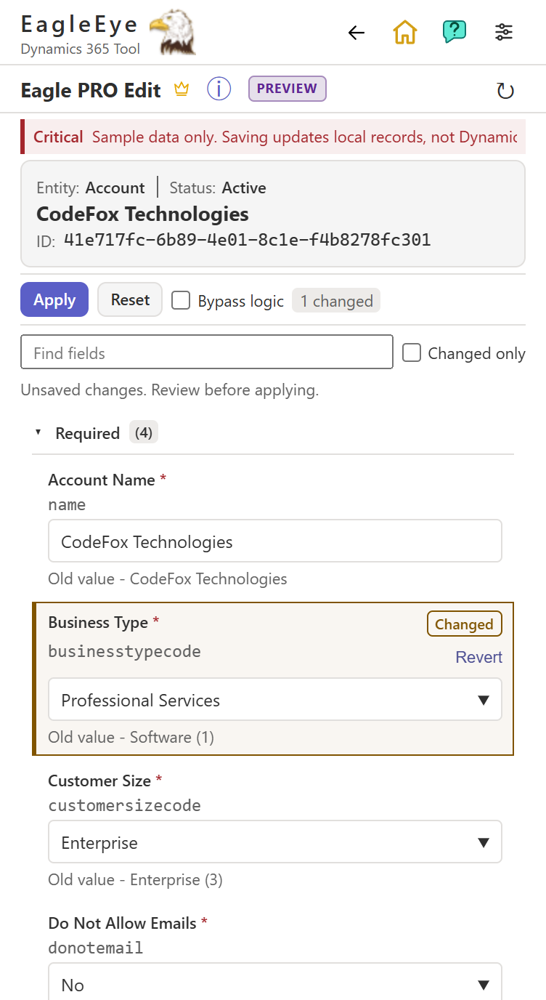

# EagleEye Help

EagleEye adds a side panel to Dynamics 365 model-driven apps. It sits beside your record, so you can find a tool, inspect fields, review audit history or edit with Eagle PRO Edit without leaving the form.

**Get EagleEye:** [Microsoft Edge Add-ons](https://microsoftedge.microsoft.com/addons/detail/eagleeye-for-dynamics-365/gphpjheamaiiacfgadcnkhjhpfmmicbf) | [Chrome Web Store](https://chromewebstore.google.com/detail/eagleeye-for-dynamics-365/mbloodacopidbejilogaefkkdolcfmfg)

## EagleEye beside your record

*Figure 1. The Account form stays on the left while EagleEye Home is docked on the right. Select the image to open it full size.*

| Callout | What it shows |
|---|---|
| Model-driven app | Your familiar app workspace. |
| Current account record | The record name, key information and the form tabs. |
| Your record stays visible | Keep the form in view while you use the sidebar tools. |
| EagleEye sidebar | Home, settings and tools docked beside the record. |
| Find the right tool | Search, switch list / grid, or sort the tool cards. |
| Tools for your form | All Fields, Audit History, PRO Edit and more. |

## The sidebar, section by section

*Figure 2. The complete Home screen, captured in one sidebar view. Select the image to open it full size.*

| Area | What it does |
|---|---|
| Navigation | The icons at the top right: Home, Settings and, in newer builds, Help. This capture is from v5.16.0, which still shows the Future Releases rocket. |
| Connection and refresh | Check the tab connection and reload the current view. |
| Find a tool | Search features by name. |
| Choose your view | Switch between list and grid, and sort your tools. |
| Favorite tools | Star the tools you use most for quick access. |
| Form tools | Inspect or work with the current record. |
| Table / Grid tools | Tools for table-level work. |
| Navigation and admin | Open records and explore administration tools. |
| Developer tools | Explore developer utilities. |

### Reading the badges

- A **crown** marks a premium tool.
- **P** marks a Preview tool: usable, but still being refined.
- **U** marks an Upcoming tool. Its card is dashed and disabled until it is released.

## Eagle PRO Edit

*Figure 3. Eagle PRO Edit with one changed field. Sample data only.*

1. Open a saved record and choose **Eagle PRO Edit** from Form tools.
2. Change the fields you need. Changed fields are highlighted and counted.
3. Select **Apply**, review the Old and New values, then confirm.

| Control | What it does |
|---|---|
| Apply | Opens the review step before anything is saved. |
| Reset | Discards your edits. |
| Bypass logic | Optional. Skips custom logic on the save and needs a separate privilege. |

> **Live data.** Eagle PRO Edit changes real records and has no automatic undo. An Inactive record can be edited, but it is flagged and needs an extra acknowledgement before you save. Saving never reactivates it.

## About these images

- Figure 1 comes from the local Web App demonstration and a fictional **Blue Orchid Company** record. The browser, record and connection are simulated.
- Figure 2 is the native extension **v5.16.0** home screen in the Light theme with the B/W icon style. The connection indicator is simulated, not a live CRM session.
- Figure 3 comes from the local Web App demonstration with sample data.
- Installed features and availability may differ from the images. Upcoming and disabled tools stay visibly marked.

## Need more?

Videos for each feature appear above this guide in Help. Questions or ideas: [you.techconnect@gmail.com](mailto:you.techconnect@gmail.com).
