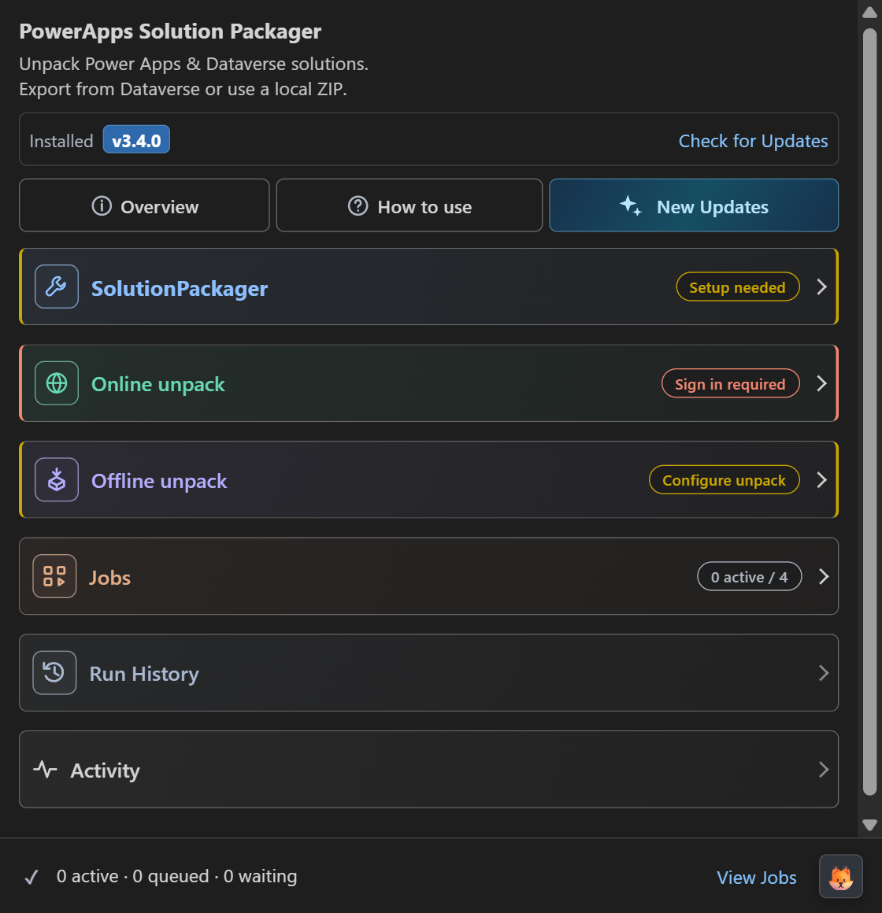
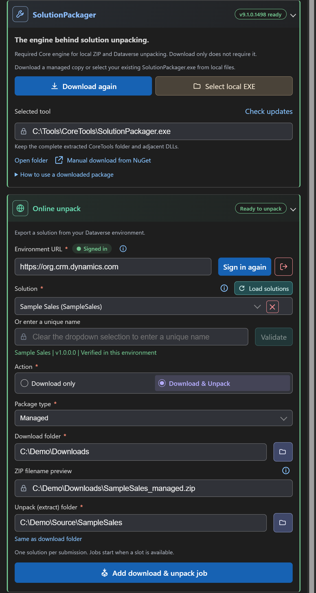
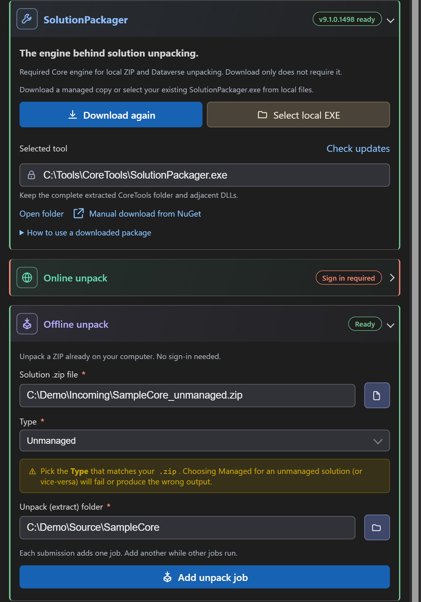
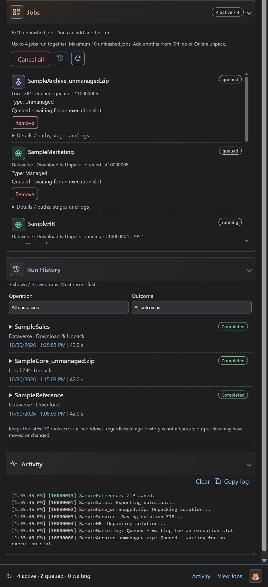

#  PowerApps Solution Packager

### Export. Download. Unpack. Stay in VS Code.

[](https://marketplace.visualstudio.com/items?itemName=codefox.d365-solutions-unpacking-agent-vscode)
[](https://code.visualstudio.com/)
[](https://marketplace.visualstudio.com/publishers/codefox)

Turn **Power Apps, Dynamics 365, and Dataverse solutions** into ZIP artifacts
and source files without leaving your editor. Export from an environment or
unpack a ZIP you already have—all through one guided sidebar.

> 🟢 **Version 3.4.0:** online solution export, download-only
> mode, offline unpack, and online download & unpack share one Jobs queue.
> Submit one solution or ZIP at a time, with up to **10 unfinished jobs** and
> **4 running together** across all three workflows.
> ZIP downloads keep both copies on a filename collision. Shared/overlapping
> unpack destinations wait for exclusive access instead of writing concurrently.
> Jobs now uses compact rows with boxed workflow icons, visible package type
> and expandable details. Per-job progress/actions, Activity and the footer
> are unchanged.

---

## 🟢 Install

**[Install from the Visual Studio Marketplace](https://marketplace.visualstudio.com/items?itemName=codefox.d365-solutions-unpacking-agent-vscode)**

```shell
code --install-extension codefox.d365-solutions-unpacking-agent-vscode@3.4.0
```

## 🔷 Choose the workflow that fits your task

| Workflow | What you get | Sign-in required? | SolutionPackager required? |
|---|---|---|---|
|  **Download only** | Export a solution and save its ZIP | Yes | No |
|  **Download & Unpack** | Export, save the ZIP, and extract source files | Yes | Yes |
|  **Offline unpack** | Extract source files from an existing solution ZIP | No | Yes |

Online exports support **Managed** or **Unmanaged** packages. For offline
unpacking, choose the type that matches the ZIP. Packing source folders into
solution packages and importing solutions are not supported yet.



### Download & Unpack online

Configure SolutionPackager, choose an online solution, and save both its ZIP and
unpacked source files.



### Unpack an existing local ZIP

Use the same SolutionPackager setup with a local ZIP and an unpack destination.
No sign-in is required.



### Track multiple jobs, queued work and saved results

The sample queue has four running jobs and two queued jobs. Jobs stays scrollable,
Run History holds saved outcomes, and Activity shows timestamped technical details.



## ✨ Features that make everyday work easier

| Feature | What it means for you |
|---|---|
| **🧭 Guided sidebar** | Set up the shared tool, choose offline or online work, and follow clearly ordered steps. |
| **🔎 Searchable solution selection** | Load your environment's solutions, filter the list, or enter a unique name manually. Reloading clears the previous choice and search without changing your folder paths. |
| **🌐 Environment confidence** | One editable environment URL is shared by sign-in, solution loading, validation and export. Changing it invalidates environment-bound solution choices, without discarding your manually entered name or output folders. |
| **📍 Your folders, your workflow** | Choose where ZIPs and extracted files are saved. Recent environment URLs and form values are remembered for convenience. |
| **⏳ Clear progress and control** | Follow each job's export, download and unpack stages, cancel individual work and open output folders without stopping other jobs. |
| **📋 Persistent Run History** | Review completed, failed, and cancelled runs, with stage results, duration, paths, and error details. |
| **🎨 Native VS Code appearance** | Colored titles, boxed icons and shaded header gradients identify SolutionPackager, Online, Offline, Jobs and History against neutral card bodies. SolutionPackager has the strongest gradient; Activity has a quieter neutral gradient and the same minimum header height. Both side borders remain reserved for status; high-contrast themes keep plain headers. Compact themed actions, read-only/disabled lock cues and thin scrollbars keep the sidebar readable. The docked footer is unchanged. |
| **📌 Docked status feedback** | A compact footer stays outside the scrolling forms. It shows progress, cancellation, output-folder access, and Activity; completed messages can be dismissed. The CodeFox toggle sits in the footer rather than over inputs. |
| **🔔 Quiet extension updates** | A slim strip below the description shows **Installed**, a blue version badge and **Check for Updates**. One dismissible panel below it shows available releases, check results, installation progress or errors. No extra update popups. |

> 🛡️ **Preserve existing files—not an automatic backup.**
>
> Unpacking uses `/allowDelete:No`, so files already in the destination but absent
> from the incoming ZIP are preserved. Updated components can still overwrite
> existing unpacked output files. Export ZIPs use Keep Both filenames instead
> of automatically replacing an existing ZIP.
> Commit or back up important local changes before unpacking.

---

## 🚀 Quick start

### 1. Prepare SolutionPackager when you need to unpack

Open the extension's sidebar and expand **SolutionPackager**.

- Choose **Download** to let the extension manage the tool. **Check updates** sits
  beside the read-only **Selected tool** path.
- Or choose the sandstone **Select local EXE** button to select your existing executable.

Skip this step if you only want to download a solution ZIP.

### 2. Choose offline or online

#### 📂 Unpack a local ZIP

1. Expand **Offline unpack**.
2. Browse to your solution ZIP.
3. Select **Managed** or **Unmanaged** to match that ZIP.
4. Choose an unpack folder and click **Add unpack job**.

**No environment URL or sign-in is needed.**

The Offline unpack badge and both side borders start **yellow** with
**Configure unpack** while setup is incomplete. Clicking **Add unpack job**
with missing prerequisites turns them **red**: both empty fields show
**Configure unpack**, one missing field names **Configure solution .zip file**
or **Configure unpack folder**, and completed fields without the tool show
**Configure SolutionPackager**. Inline errors explain each missing prerequisite.
Feedback updates as you type or browse; the badge and borders turn **green**
with **Ready** once the tool is ready and both required fields are filled.
Ready indicates form completeness, not that the ZIP has already been unpacked.

#### 🌐 Export from your environment

1. Expand **Online unpack**, enter or choose a recent environment URL, and click **Sign in**.
2. Complete the browser sign-in. The indicator beside **Environment URL** confirms
   the connection. The slim blue **Sign in** / **Sign in again** button and red
   **Sign out** icon sit beside the URL input. The bare information
   icon beside the label (tooltip: **Session details**) expands your username,
   connected environment, and session expiry, and stays highlighted while open.
3. Click **Load solutions** and use the searchable dropdown, or enter a unique name and choose **Validate**.
   The slim Load button and bare information icon share the Solution label row;
   the ZIP filename preview has its own information toggle.
4. Choose **Managed** or **Unmanaged**.
5. Choose **Download only** or **Download & Unpack**, and set the required folders.
6. Click the final action button.

After a valid online or offline job is accepted, its submitted form, session Details,
solution dropdown and Help collapse. **Jobs** and **Activity** open; **Run History**
stays collapsed. Invalid forms and pending checks do not trigger this panel change.
Use **Add another run** or reopen a form to submit more work while other jobs run.
Controls retain their normal setup, validation and queue-limit gates.

**Compact header and help:** the title sits above a smaller, two-line description
(which can wrap further in very narrow sidebars). A slim version strip
below the description groups **Installed**, the blue version badge and a
right-aligned **Check for Updates** link-style button, wrapping when necessary.
**Overview** and **How to use** are quiet outlined information
and question-mark buttons in one close-spaced row with the highlighted **New Updates**. Labels stay visible
whenever all three buttons fit, using their actual widths, spacing and font size
rather than a fixed sidebar breakpoint. When space runs out, only the first two
buttons hide their text; their icons, tooltips, accessible names and keyboard
focus remain available. Labels return automatically when space becomes available.
**New Updates** keeps its
sparkle icon, text and styling at both sizes. All three open one shared panel,
and the selected button is highlighted. Selecting
the other section replaces the content; selecting the active button, Close, or
Escape closes it. Overview explains the app and unpacking safety; How to use
illustrates setup, Online, Offline and multiple jobs in order.

### One editable online area

The separate Authentication and Download cards are combined into **Online unpack**.
You can enter the environment, solution name, package type and folders in any order,
including before sign-in. Choosing a dropdown solution disables the alternative
manual-name field and **Validate**; use **Clear selection** to restore them.
Other controls retain their existing operation gates; mandatory authentication, solution and
SolutionPackager checks still run before execution.

- A manual unique name is checked in the selected, authenticated environment.
  **Validate** shows its friendly name and version or a specific error. If you skip
  that button, the final action validates the name before starting a run.
- A missing solution is distinguished from a failed lookup or access-denied
  response. The host checks the solution again before export, so a previously
  valid or selected name cannot bypass server validation.
- Changing the name, environment or session invalidates pending checks. A stale
  response cannot start a run for different input. Editing output/action options
  during a check also cancels its pending automatic run.
- Choosing **Download only** clears and disables the unpack folder, its browse
  button and **Same as download folder** action. Switching to **Download & Unpack**
  re-enables them; select an unpack folder again. A delayed picker response cannot
  restore an unpack path while Download only is selected.
  The compact Action selector keeps visible circular radio indicators and the
  same keyboard, selection and operation-locking behavior.
- The badge does not show **Ready** just because fields are filled. It includes
  the target session, solution verification and required SolutionPackager.
- Colored **Offline unpack** and **Online unpack** titles, boxed unpack/globe
  icons and the workflow descriptions distinguish local ZIP work from Dataverse
  export. Field actions use the approved filled/outline palette; Info and output
  pop-out icons have no outer box. Both workflows still open
  Activity and collapse their setup forms when a valid run starts.

---

## 🛠️ SolutionPackager setup and download recovery

### Setup guidance without repeated warnings

The shared **SolutionPackager** card shows **Setup needed** when no executable is
configured. Its blue title and boxed wrench identify the shared unpack
engine, with a clear read-only selected path. **Download/Download again/Update** and
**Select local EXE** share the first action row. **Use managed copy**, **Open folder**
and manual download remain available through their existing actions.
Warning/error badges and the
left/right status borders remain independent of the card colours.
Offline starts with a yellow **Configure unpack** badge and uses red after an
invalid submission. Online retains its authentication/validation status. Neither
workflow shows Ready while
SolutionPackager is unavailable.

If you attempt unpacking without it, that workflow shows one inline requirement
and **Set up SolutionPackager**. The action opens the shared setup card; it does
not start a download or change your custom selection. The message and action
disappear when a valid executable becomes available. **Download only** never
shows this requirement. Invalid custom executables and installation/download
failures still report errors. No executable is bundled by this release.

### Output and shared-tool protection

The host automatically checks real output paths and coordinates jobs across
participating VS Code windows on the same machine:

| Output situation | Behaviour |
|---|---|
| Same solution/download folder | Keep Both: use a new ZIP filename if the base exists or is reserved. |
| Different solutions/download folder | Allow distinct filenames; actual filename collisions use Keep Both. |
| Same exact unpack destination | Confirm shared-folder updates; execute sequentially in submission order. |
| Different solutions/same unpack destination | Inline warning plus one submission confirmation; sequential use may mix/overwrite components. |
| Separate, non-overlapping unpack destinations | Allow parallel execution within the shared four-slot limit. |
| Parent/child unpack destinations | Non-blocking overlap warning with Cancel/View Jobs access; automatically wait and write sequentially. |

Online ZIP names start with `<solution>_managed.zip` or `<solution>_unmanaged.zip`.
When that name is already present or reserved, a timestamp and short identifier
are added, for example `Sales_unmanaged_20261029_150541_a81f2c90.zip`. A read-only
preview shows the base; the accepted exact filename appears in confirmation,
Jobs details and Run History. A small Keep Both notice replaces ZIP overwrite
popups. No manual filename editing or ZIP overwrite mode is introduced.

Destination guidance updates for typed/browsed folders. Shared exact folders and
non-empty destinations require confirmation; choose another folder, use the same
folder sequentially (Queue update if busy), or Cancel. Consent is rechecked in
the host against the actual destination/current owners. A parent/child overlap
alone does not add a blocking popup; normal non-empty-folder checks still apply.
Folder names/history do not prove which solution is already present.

**Waiting for destination** counts toward ten unfinished jobs, but consumes no
execution slot. Conflicting destination intents are ordered and acquire exclusive
write ownership atomically before starting. Cancel a waiter in Jobs; independent
destinations remain eligible. The actual unpack folder is never silently changed.

Protected input ZIPs, in-use runtime files, invalid ownership and other unsafe
source/write conflicts still fail explicitly. Keep local input ZIPs outside their
unpack destinations. A warning/confirmation never bypasses these protections.

An unpack run pins its validated SolutionPackager copy. Reinstall/update and
selection changes through the extension are blocked while that ownership is held
(a conflicting action reports an error; it is not silently queued).
This does not prevent manual edits by external programs.

Exports finalize a complete temporary file with an atomic no-replace operation.
If an external program creates the allocated ZIP in the meantime, the job fails
without overwriting it; submit a new request to allocate another name. Unpack is not
transactional: cancellation/failure can still leave partially updated files.

Interrupted resource ownership is not automatically discarded. If an ownership
error persists after a crash, do not delete locks merely to bypass it. Reviewed
recovery is temporarily unavailable; its disabled Jobs button does not release
reservations or restart prior work. Independent, non-conflicting runs can still
be submitted through the normal forms.

### Let the extension manage the tool

The extension downloads the latest stable **Microsoft.CrmSdk.CoreTools** NuGet
package, extracts SolutionPackager and its dependencies, and caches them in
VS Code user storage—not `Program Files`.

- **No administrator installation is required for the normal managed setup.**
- The tool card shows the active tool version.
- Its labeled primary action changes between **Download**, **Update**, and
  **Download again** (the existing reinstall action). Tooltips provide the full action and target version.
- **Check updates** checks the tool, independently of extension update checks.
- The download action remains visible when a custom EXE is selected. **Download**
  prepares a managed installation without replacing your custom
  selection; choose **Use managed copy** when you want to switch.
- A failed tool download leaves the previously installed copy available.

### Use a local copy

Use the folder button beside **Select SolutionPackager.exe from a local folder** and select the
executable inside a fully extracted CoreTools folder. The read-only field displays
the active path, with the full path in its tooltip. **Open folder** reveals the
validated active executable in its containing folder. Keep these files together:

```text
coretools\
  SolutionPackager.exe
  Microsoft.Crm.Sdk.Proxy.dll
  Microsoft.Xrm.Sdk.dll
  ...other files from the package
```

The extension checks the selected executable's identity, readability, and required
companion DLLs. The extracted folder can be in Downloads or another accessible
location; select the EXE, not the ZIP, NuGet package, or containing folder.

Choose **Use managed copy** to remove the custom-path override.

### If automatic download fails

Automatic tool downloads run inside the extension—not through Edge or Chrome.
Temporary network/server failures receive one retry; certificate problems,
access-denied responses, and cancellation do not.

After a NuGet failure, choose:

| Action | What happens |
|---|---|
| **Download manually** | Open the official NuGet page using your default browser, detected Chrome/Edge installation, or copy the link. |
| **Select custom EXE** | Point the extension to a complete local SolutionPackager copy. |
| **Show Logs** | Inspect the underlying download failure in the Output channel. |

For manual setup:

1. Download [Microsoft.CrmSdk.CoreTools from NuGet](https://www.nuget.org/packages/Microsoft.CrmSdk.CoreTools).
2. Open the `.nupkg` as a ZIP, or rename a copy to `.zip`, and extract the complete archive.
3. Locate `SolutionPackager.exe` under `content\bin\coretools` or
   `contents\bin\coretools`, depending on the package layout.
4. Use the folder button beside **Select SolutionPackager.exe from a local folder** in the extension.

Use only download methods approved by your organisation. Choosing another
browser does not guarantee that an organisation-wide restriction will allow access.

[Read Microsoft's SolutionPackager documentation](https://learn.microsoft.com/power-platform/alm/solution-packager-tool).

---

## 📋 Follow a run—and find it again later

### Live progress

**Activity**, the status footer, and the progress bar show the current stage.
Tool output is also available in the extension's Output channel.

- **Cancel** an active solution export/unpack run.
- Use **Open folder** after a successful download or unpack.
- Read clear errors without losing the distinction between a successful download
  and a failed unpack.

### Run History

Expand **Run History**, between Jobs and Activity, when you need it.

- **Lazy-loaded:** no history request on sidebar startup.
- **One in-flight read:** repeated toggles do not trigger duplicate requests.
- **Your choice stays respected:** collapsing during loading does not cause the
  response to reopen the section.
- **Persistent:** keeps the latest **50 runs**, regardless of age, across VS Code restarts.
- **Easy to scan:** shows the latest **five** first; expand **Earlier runs** for the rest.
- **Ordering:** newest run-start timestamp first, not completion order.
- **Outcomes:** compact rounded status pills distinguish Completed, Cancelled,
  Failed and Interrupted without replacing the outcome text.
- **Collapsed on open:** saved rows and **Earlier runs** start collapsed whenever
  the History section is reopened. Live updates while it stays open retain
  the user's existing expanded rows.
- **Compact output access:** expand a run to find the existing ZIP-folder and
  unpack-folder pop-out icons beside **Operation**. Both are retained when both
  outputs are available; tooltips identify their targets.

Click a run summary to inspect its operation, environment, package type,
timestamps, duration, stage results, output paths, packager version, and failure
message. The solution version is included when available from the loaded list;
offline entries use the ZIP filename rather than guessing metadata.

Summary timestamps use:

```text
10/21/2026 | 9:58:19 PM | 293.1 s
```

The date and time share the same theme-aware accent color.

To remove saved summaries, run **PowerApps Solution Packager: Clear Run History**
from the Command Palette. This does **not** delete ZIPs or extracted files.

> **History is a record, not a restore point.** Recorded paths may refer to files
> that were later moved, replaced, or deleted.

---

## 🔐 Sign-in and security

### Secure sign-in

Interactive authentication uses **MSAL**, authorization code flow, and **PKCE**
with a local loopback redirect. Tokens are cached using VS Code **SecretStorage**.

- Sessions are reused across API calls, with a configurable lifetime of **1–24 hours**.
- Manual sign-out, the configured lifetime, or an expired/revoked refresh token
  requires authentication again.
- The webview uses a strict Content Security Policy and nonce-protected scripts;
  network and filesystem operations are handled by the extension host.

---

## 📋 Jobs: multiple runs without duplicate forms

### More solutions. Less waiting.

Each submission adds exactly one job. Add another local ZIP, online download or
online download-and-unpack while earlier jobs continue. There is no separate
parallel mode or multi-select form.

| Surface | Purpose |
|---|---|
| **Jobs** | Unfinished work and individual cancel/remove. Saved final results appear only in Run History. |
| **Activity** | The existing chronological technical log, identified by job. Clear and Copy log sit inside the expanded card, in a compact toolbar above the log. Clear affects only this log; Copy log copies the displayed timestamped lines without clearing them or changing running jobs. Copy success or clipboard errors appear inside Activity, not in the footer. |
| **Run History** | Final results with operation/outcome filters, without a search box. History is not a backup. |

The host enforces **10 unfinished jobs** and **4 shared execution slots per
window**. An online Download & Unpack request is one job through all its stages.
Waiting for sign-in/setup/destination does not occupy an execution slot; cancelling work keeps
its slot until the owned worker has stopped. Dataverse throttling can delay work.

After acceptance, choose **Add another run** to reuse the existing form or open
the other workflow. Only the submitted form collapses; unrelated draft values
remain intact. **Jobs** and **Activity** open; **Run History** stays collapsed.
ZIP collisions use Keep Both; accepted shared unpack destinations
wait sequentially. Unsafe protected-source/path conflicts remain blocked.
Accepted jobs appear directly in Jobs without a separate job-added confirmation
or **View job** button. Important notices and submission errors remain visible.

**Jobs shows unfinished work only:** running, queued, waiting and cancelling jobs,
newest submission first. Completed, failed and cancelled results leave this list
only after they have been saved to Run History. If saving fails, the result stays
visible with an error; **Refresh Jobs** attempts to save it without rerunning it.
Each live row keeps the last **100 log messages**.

Jobs use compact rows with boxed workflow icons (unpack, download or globe),
a status pill and a visible **Type: Managed/Unmanaged** line, without side bars.
Existing progress messages and actions stay visible; expand **Details / paths,
stages and logs** for labeled paths, timings and technical details.
Only the list scrolls, up to 360px or 40% of the viewport height, whichever is
smaller; the Jobs header and toolbar stay outside it.

**Cancel all** requires confirmation. There is no Clear finished action because
saved final jobs leave the live list automatically. **Retry** (including Run History)
and **Review interrupted jobs** are visible but disabled, with their UI/host routes
removed for now. To run something again, submit a new request through the normal
form and recheck paths. Nothing restarts automatically after interruption.
This disables manual job retry, not the existing bounded response to Dataverse
HTTP 429 throttling or tool-download transient failures.

The persistent **Run History** independently retains the latest **50 final runs**
across restarts, ordered by start time. It shows five matching entries first and
places the rest under Earlier runs. There is no age-based expiry.
Entries are simple expandable rows with dashed separators, not nested cards. A
small-font retention note explains the 50-run limit. Clearing history never
deletes output files or cancels active work.

The three Help controls share one left-aligned row. **Overview** and **How to use**
become icon-only only when their labels cannot fit alongside **New Updates**.
**New Updates** keeps its sparkle and shiny background, without a prefix
arrow, and highlights queue limits, ZIP collision handling, shared destinations
and saved outcomes without a version heading. It shares
the existing Help panel; the extension update-check/install panel remains separate.
Close/dismiss controls use consistent red styling, including the CodeFox panel.

The compact Help panel uses flat workflow rows and illustrated controls:
**Overview** explains SolutionPackager and the `/allowDelete:No` safety rule;
**How to use** covers setup, Online, Offline and multiple jobs in order.
Content scrolls within 220px on wide views or 300px on small screens, also
limited by viewport height. Help links open the existing workflow cards.
Text/path fields show their full current value on hover, including read-only
and disabled fields; password and explicitly sensitive inputs are excluded.
The solution-clear button uses a 22px rounded-square target with the same X glyph.
The real Action radio inputs use explicit circular styling rather than
platform-native painting, retaining their keyboard behavior and a themed
focus outline around the label without an extra square on the radio.

**Jobs** has a copper title and boxed queue icon on a neutral surface.
SolutionPackager remains the strongest core-engine heading. Workflow title/icon
colors and the warning/error/ready markers on both side borders remain independent.

---

## 🛟 Help and support

| If you encounter… | Start here |
|---|---|
| Automatic tool download fails | Use **Download manually**, extract the complete package, then use the local EXE folder button to select `SolutionPackager.exe`. |
| Offline unpack fails | Check that Managed/Unmanaged matches the ZIP and that the required SDK DLLs remain beside the executable. |
| Authentication expires | Authenticate again; the configured lifetime or your environment's token policy may have ended the session. |
| No extension update notice | Your version may already be current or newer, the daily result may be cached, or the lookup may have failed. Check the Output channel for errors. |
| Old files remain after unpacking | This is intentional: files absent from the new ZIP are not deleted. Review the destination before reusing it. |

- **Author:** Jadhav Shubhamm
- **Email:** [you.techconnect@gmail.com](mailto:you.techconnect@gmail.com)

---

🦊 **CodeFox — Driving AI-Powered Delivery Excellence**
